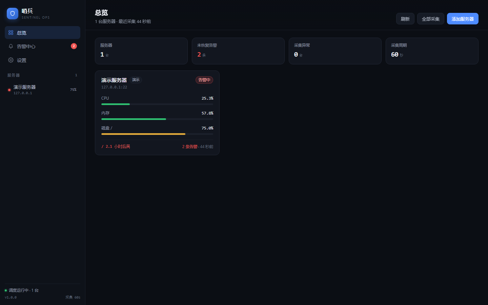
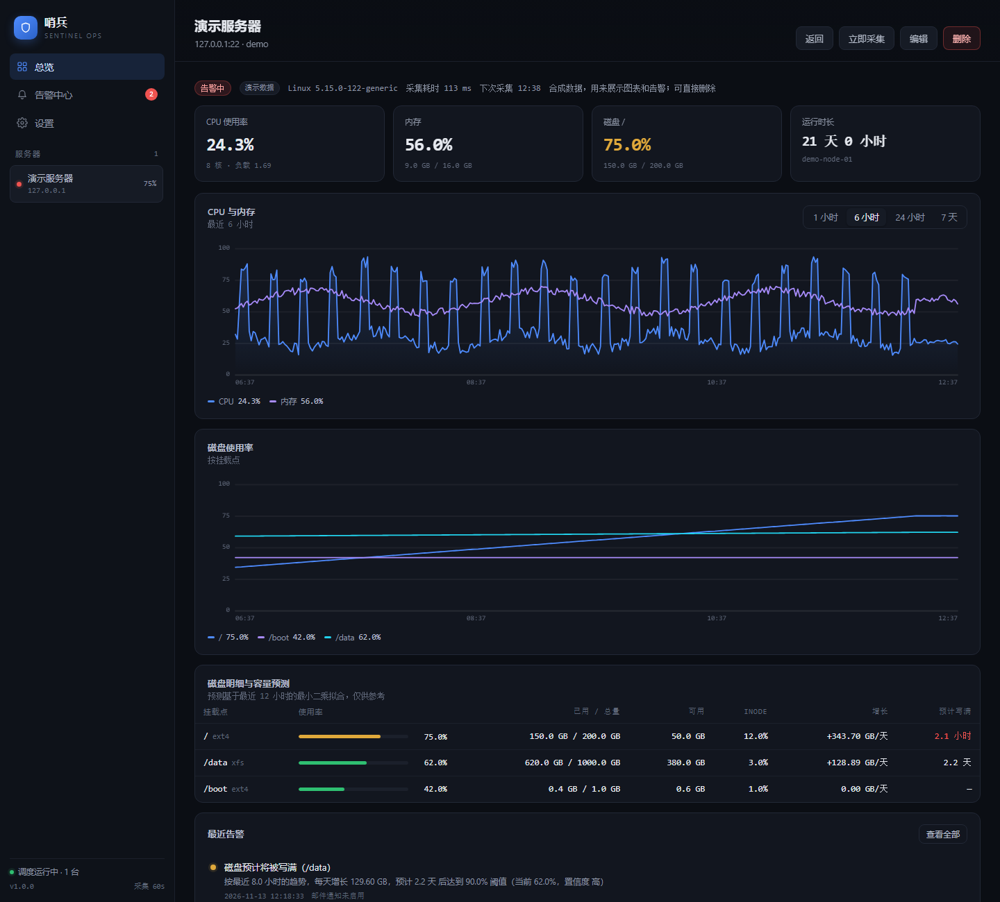
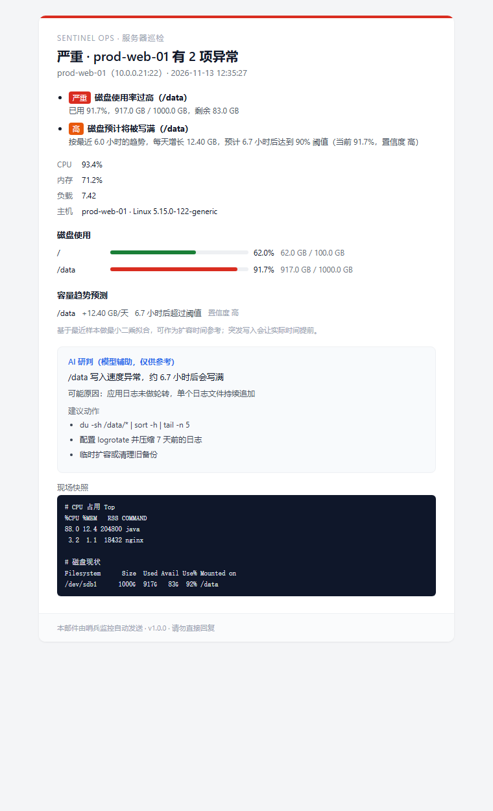
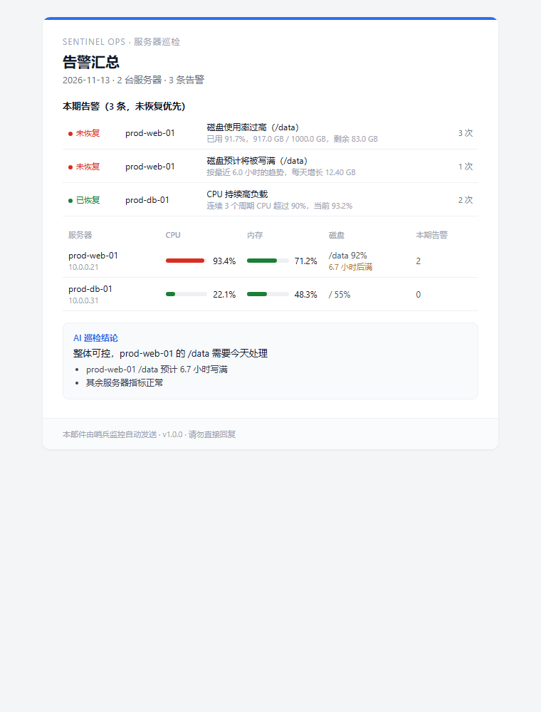

# 哨兵 / Sentinel Ops

> 填 IP、用户名、密码就能用的服务器巡检工具：定时采集 CPU / 内存 / 磁盘，磁盘快满之前提前算给你看，
> 异常时（可选）交给 DeepSeek 判断严重性并写进邮件。
> 不用装 agent（密码 SSH 跑只读命令），整个项目**只依赖 paramiko**，其余全是标准库，`python run.py` 就能跑。

> 🎓 **学习项目**：这是我的个人练手仓库（第一次把完整项目放到 GitHub 上），用来把
> 「Python 标准库 + SSH 采集 + 单页前端 + 邮件告警」串成一个能跑的东西。
> 中文注释写得啰嗦，是留给自己以后复习的；代码优先可读性，不追求生产级健壮性。
> 欢迎交流，但别直接套到生产环境上。







## 功能

- **绑定服务器**：填 IP / 端口 / SSH 用户名 / 密码，保存即开始巡检；支持测试连接。
- **定时采集**：全局周期（默认 60 秒）可改，单台服务器也能单独设周期；采集并发可调。
- **指标**：CPU 使用率、核数、负载、内存、Swap、运行时长、每个挂载点的容量 / 使用率 / inode、主机名与内核。
- **磁盘写满预测**：对每个挂载点做最近 12 小时的最小二乘拟合，算出 GB/天 与"还有多久到阈值"，
  带 R² 置信度；增长太慢自动不预测，避免噪声。
- **告警**：CPU/内存连续 N 个周期超阈值、磁盘超阈值、inode 超阈值、预测即将写满、SSH 失联、恢复通知。
  同一问题有冷却时间，不会刷屏；每小时有邮件总量上限。
- **AI 研判**（可选）：只在命中规则时调用一次，让模型判断"要不要紧、可能是什么原因、先做哪几步"，
  结果附在邮件里；模型挂了不影响告警送达。
- **邮件**：SSL / STARTTLS / 明文三种 SMTP，HTML + 纯文本双份，支持多收件人。
- **提醒节奏**：可以「异常立即发信」，也可以「只进汇总」——按天或按周发一封，
  列出未恢复和本期已恢复的告警，再附全量体检表；不想被实时打扰就选后者。
- **控制台**：总览卡片、CPU/内存曲线、每块盘的使用率曲线、磁盘明细与预测表、告警中心。
- **数据**：SQLite 单文件，默认保留 14 天，自动清理；密码与 API Key 加密落盘。

## 快速开始

### Windows

```bat
:: 需要 Python 3.9+，且已安装 paramiko
pip install paramiko
start.bat
```

### Linux

```bash
pip3 install paramiko
python3 run.py --host 0.0.0.0 --port 8088 --open
```

启动后打开 <http://127.0.0.1:8088>。首次启动会自带一台"演示服务器"（合成数据，不会发邮件），
用来先看看图表和告警长什么样；不需要就点删除，或用 `--no-demo` 启动。

第一次真正使用：

1. 右上角「添加服务器」→ 填 IP、端口、用户名、密码 → 点「测试连接」确认能通 → 保存。
2. 打开「设置」→「邮件通知」，填 SMTP 和收件人 → 点「发送测试邮件」。
3. （可选）「AI 研判」里填 OpenCode Go 或 DeepSeek 的 Key → 点「测试模型」。
4. 想安静一点，就在「汇总与提醒节奏」里把告警投递方式改成「只进汇总」，选每天或每周。
5. 剩下的交给定时任务；有异常会在「告警中心」看到，并按你选的方式发邮件。

## 接入 OpenCode Go 的 DeepSeek 套餐

OpenCode Go 提供 OpenAI 兼容端点，模型 ID 是 `deepseek-v4.1-flash` 或 `deepseek-v4-pro`：

| 配置项 | 值 |
| --- | --- |
| 服务商 | OpenCode Go（DeepSeek 套餐） |
| Base URL | `https://opencode.ai/inference/go/openai/v1` |
| 模型名 | `deepseek-v4.1-flash`（便宜）/ `deepseek-v4-pro`（更强） |
| API Key | OpenCode 控制台 → Go → 复制 API Key |

在设置页选「OpenCode Go」会自动填好 Base URL 和模型名，只需要粘 Key。

几点实话：

- Go 是给 **coding agent** 设计的订阅，文档明确说会监控流量类型。监控告警属于低频非典型流量，
  所以默认只在**命中规则时**调用一次（一封信一次，约 1k token），不要改成"每个周期都调"。
- 请求会带 `User-Agent: sentinel-ops/1.0` 和 `x-opencode-session` 头，符合它文档里对客户端的要求。
- 想更稳就走 **DeepSeek 官方 API**（`https://api.deepseek.com/v1`，`deepseek-chat`），
  按量付费，一次研判不到一分钱。任何 OpenAI 兼容端点（vLLM / Ollama / 硅基流动）都能填进"自定义"。

**如果提示「模型返回空内容」**：多数是推理型模型把 `max_tokens` 预算花在思考上了
（响应里 `finish_reason=length`、正文为空）。程序会自动把预算翻倍重试一次；
还不行就把「最大输出 token」调到 1500–2000，或者换 `deepseek-v4.1-flash` 这类非推理模型。
如果 `finish_reason` 是 `stop` 却仍然为空，多半是网关不支持当前的请求格式——
先用「测试模型」确认端点，再看 `data/sentinel.log` 里记录的原始返回。

## 邮件怎么配（QQ / 163 为例）

| 项 | QQ 邮箱 | 163 邮箱 |
| --- | --- | --- |
| SMTP | `smtp.qq.com` | `smtp.163.com` |
| 端口 / 加密 | 465 / SSL | 465 / SSL |
| 账号 | 完整邮箱地址 | 完整邮箱地址 |
| 密码 | **授权码**（不是登录密码） | **授权码** |

授权码在邮箱网页版「设置 → 账户 → POP3/SMTP/IMAP」里开启后生成。
企业邮箱/自建 Postfix 按实际填，587 端口选 STARTTLS。

## 告警是怎么判的

```
采集 ──► 规则引擎 ──► 冷却/去重 ──► [命中规则时] 模型研判 ──► 邮件
          │                                              └── 失败则跳过，规则照发
          └── 预测：最近 12h 线性拟合，斜率 > 0.2 GB/天 才认为在增长
```

- **CPU/内存**：连续 `N` 个周期都超过阈值才算（默认 90% × 3 次、95% × 3 次），避免毛刺。
- **磁盘**：单次超过阈值立即告警（默认 90%）；已经超阈值的盘不再重复报"预计写满"。
- **预测**：`(总量 × 阈值 − 当前已用) ÷ 每小时增量 = 剩余小时数`；
  落在 `disk_forecast_hours`（默认 72 小时）内就提醒，≤24 小时升为"高"，≤6 小时升为"严重"。
  置信度低（样本少、R² 低）时只保留"马上要满"的判断。
- **失联**：连续 `offline_after` 次（默认 2 次）SSH 失败才报，避免网络抖动误报。
- **冷却**：同一 `服务器 + 问题` 在 `cooldown_minutes`（默认 360 分钟）内只发一封；
  严重级别升高会立刻再发一封。
- **恢复**：指标回落后发一封"已恢复"，并关闭该告警。

预测是**趋势外推**，不是承诺：突发写入（比如半夜跑个备份）会让实际时间大幅提前。
它解决的是"没人注意到 /var 每天涨 2%"，不是替代磁盘配额告警。

### 提醒节奏：实时，还是按天/按周

默认「异常立即发信」。不想被实时打扰，就把设置里的「告警投递方式」改成「只进汇总」，
再选每天或每周：

| 模式 | 行为 |
| --- | --- |
| 异常立即发信（默认） | 命中规则就发，受冷却时间和每小时上限约束；汇总邮件（若开启）只做体检 |
| 只进汇总 · 每天 | 异常只记到告警中心，每天固定时间发一封：未恢复 + 本期已恢复 + 体检表 + AI 结论 |
| 只进汇总 · 每周 | 同上，每周固定星期发一封；周期内告警按「服务器 + 问题」归并，只报次数和状态 |



几点说明：

- **采集周期不用跟着改**。保持 60 秒，曲线和容量预测更准；只是不发即时邮件而已。
  如果连采集都想省，把周期调到 300–3600 秒即可（设置页有一排快捷按钮，最大支持 1 天）。
- 汇总模式下**不再逐条调用模型**，只在发汇总时调一次做整体结论，更省额度。
- 选了「只进汇总」会自动打开汇总开关，避免"静默模式"把告警彻底吞掉。

## 目录结构

```
sentinel/
  app.py          应用装配：配置读写、密钥、演示数据
  api.py          HTTP 层（JSON API + 静态文件 + 可选 Basic 认证）
  analyzer.py     规则引擎、告警编排、冷却去重、恢复通知
  collector.py    SSH 采集与 /proc、df 解析
  predictor.py    容量趋势预测
  llm.py          OpenAI 兼容客户端与 JSON 提取
  notifier.py     SMTP 与邮件模板
  scheduler.py    定时调度、并发采集、每日汇总、数据清理
  store.py        SQLite 存储
  secrets.py      落盘加密（Fernet，缺失时用 HMAC 流加密兜底）
  config.py       默认配置、校验与打码
  web/            单页面控制台（原生 JS + Canvas 自绘图表，零前端依赖）
run.py            启动入口
tools/seed_demo.py 给演示服务器灌历史数据
tests/            单元测试 + 端到端测试（假 SSH / 假 SMTP / 假模型）
data/             运行期生成：sentinel.db、secret.key、sentinel.log
```

## 常用命令

```bash
python run.py --help
python run.py --port 9000            # 换端口
python run.py --host 0.0.0.0         # 允许远程访问（记得设 Basic 认证）
python run.py --no-demo              # 不带演示服务器
python run.py --log-level DEBUG      # 排查采集问题

python tests/test_units.py           # 59 项单元测试
python tests/e2e.py                  # 端到端：假 SSH + 假 SMTP + 假模型，28 项
python tests/test_summary.py         # 按天/按周汇总模式，16 项
python tests/test_restart.py         # 重启后配置/密钥还在，6 项
python tests/test_autocollect.py     # 自动采集回归：不点「立即采集」也要出数据，8 项
python tools/seed_demo.py --hours 8  # 给演示数据补历史
```

## 部署成服务

**systemd（Linux）**

```ini
# /etc/systemd/system/sentinel.service
[Unit]
Description=Sentinel Ops
After=network-online.target

[Service]
Type=simple
WorkingDirectory=/opt/sentinel
ExecStart=/usr/bin/python3 /opt/sentinel/run.py --host 127.0.0.1 --port 8088 --no-demo
Restart=always
RestartSec=3
User=sentinel

[Install]
WantedBy=multi-user.target
```

前面挂 Nginx + HTTPS + Basic 认证是最省事的加固方式。

**Windows 常驻**：用 `nssm install Sentinel "C:\Python312\python.exe" "D:\sentinel\run.py"`，
或把 `start.bat` 丢进「启动」文件夹。

## 安全须知

- **SSH 密码是加密存的**（`data/secret.key` 是密钥，权限 600）。但拿到 `data/` 目录的人仍能解密，
  所以别把 data 目录提交到 Git（已给 `.gitignore`）。
- 默认只监听 `127.0.0.1`。要远程访问，请设「访问控制」里的用户名密码，并尽量走 HTTPS 反代。
- 本工具只执行一段**只读**的 POSIX shell（`/proc`、`df`、`ps`），不写远端文件、不需要 sudo。
- 为了免确认，默认 `host_key_policy=auto`（首次连接自动接受主机指纹）。对安全要求高就改 `strict`，
  并先把目标机指纹写进 `known_hosts`。
- 密码登录是刻意支持的（你的需求），但它比密钥弱。长期跑建议后续换成 SSH Key + 受限账号。

## 已知边界

- 只支持 **Linux 目标机**（依赖 `/proc` 和 `df`）；Windows Server 不支持。
- 只支持**密码认证**，暂不支持密钥/跳板机。
- 预测需要至少 3 个采样点；刚加进来的机器要等十几分钟才准。
- 演示服务器的数据是合成的，重启进程后它的磁盘用量会回到初始值（不影响真实服务器）。

## 许可

自用工具，随取随改。
